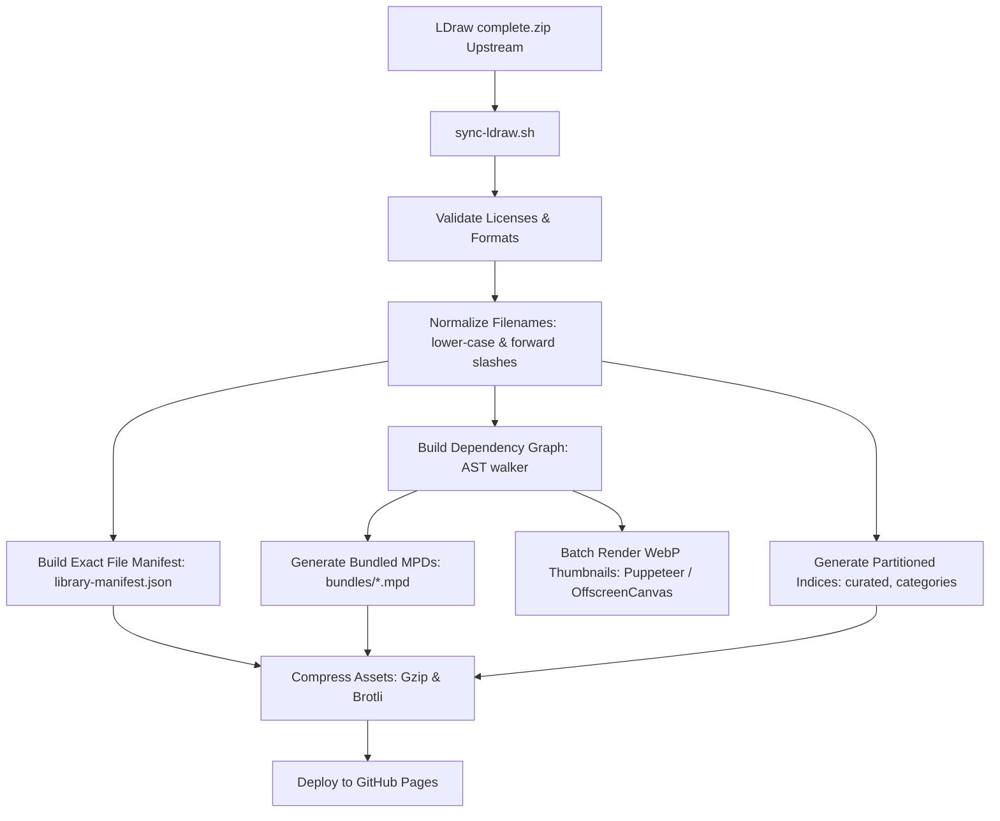

# LDraw Catalog Repository Architecture & Optimization Blueprint

This document defines the architectural blueprint and operational specification for a standalone, CDN-optimized LDraw catalog repository (**`ldraw-catalog`**), designed to be served over GitHub Pages (with optional Cloudflare / CDN edge caching) and consumed by **`brick-frame`** applications (Viewer, Studio, Brick Play).

---

## 1. Executive Summary & Root Cause Analysis

### 1.1 The Current Bottlenecks in `brick-frame`
Currently, `viewer-app/public/ldraw/` embeds an entire synced LDraw parts library directly in the application repository:
- **Repository Bloat:** 36,966 loose files across `parts/` (24,856), `parts/s/` (9,266), `p/` (1,789), `p/8/` (127), and `p/48/` (928), consuming **623 MB** on disk. This inflates git clone sizes, slows local Vite hot reloads, and burdens Vite build pipelines.
- **The Mobile Network Waterfall:** LDraw models are directed acyclic graphs of sub-parts and geometric primitives. Resolving a standard brick (e.g. `3001.dat`) requires discovering sub-files layer by layer: `3001.dat` -> `s\3001s01.dat` -> `stud4.dat`, `box5.dat`, `stud.dat` -> `cyli.dat`, `disc.dat` -> `1-4cyli.dat`, `1-4disc.dat`. On high-latency mobile networks (40–120ms RTT), this 4–5 tier waterfall takes 500ms–1500ms of serialized round-trips for a single piece.
- **The `isLikelyPrimitiveName` 404 Amplification (Critical Bug Found):** In `packages/brick-frame-simulator/src/LDraw/Resolve.elm`, line 287 contained `startsWithDigit name`. Because **94.6% of all parts (23,525 out of 24,856 files)** in `parts/` begin with a digit (e.g., `3001`, `3647`), the resolver erroneously classified almost all standard bricks as primitives. As a result, the resolver queried `/ldraw/p/<id>.dat` first for every single part, received an HTTP 404 (or downloaded Vite's 200 OK SPA `index.html`), failed `looksLikeLDraw`, and only then requested `/ldraw/parts/<id>.dat`. This doubled the network request count and latency for nearly every placed piece.
- **Monolithic 2.86 MB `parts-index.json`:** Mobile browsers must download, decode with Elm's `Json.Decode`, and allocate 24,000+ heap objects in a single pass on the main UI thread when search is activated, causing noticeable 200–500ms thread freezes and memory pressure on iOS Safari.
- **Duplicate Parsing in `Viewport.elm`:** `handlePartResult` parses incoming `.dat` text twice: once inside `Resolve.updateCache name result Parser.parseFile` and immediately again in `Parser.parseFile text`.
- **Thumbnail Pipeline Gaps:** `thumbnail-pipeline.js` lacks fallback CDN resolution, omits `parts/s/` sub-part candidate lookup, generates 404s for common primitives by trying `parts/` first, and processes queue items strictly sequentially.

---

## 2. Separate Repository Specification: `ldraw-catalog`

### 2.1 Repository Objectives
1. **Zero Bloat in App Repo:** Offload 623 MB / 37k files from `brick-frame`.
2. **One-Request Part Loading via Pre-Bundled MPDs:** Pre-compile dependency graphs so a part and all its transitive subparts and primitives can be fetched in a single HTTP GET request.
3. **Partitioned & Fast Search Indexing:** Separate curated essentials from full library indices; provide pre-filtered category subsets and chunked search metadata.
4. **Pre-Rendered Visual Assets:** Pre-generate WebP isometric thumbnails in common palette colors to eliminate client-side WebGL thumbnail rendering overhead.
5. **Deterministic Zero-404 Routing:** Provide an exact manifest / lookup table so clients never perform trial-and-error HTTP GET requests across `parts/`, `parts/s/`, and `p/`.

### 2.2 Directory Layout on GitHub Pages

```text
ldraw-catalog/
├── index.html                       # Catalog status dashboard & health metrics
├── manifests/
│   ├── library-manifest.json        # File-to-path exact mapping (O(1) client routing)
│   ├── version.json                 # LDraw release version, git sha, sync timestamp
│   └── elements-index.json          # Curated LEGO element ID -> part/color mapping
├── indices/
│   ├── parts-index.json             # Minified full index (compressed with gzip/brotli)
│   ├── parts-curated.json           # Lightweight essential palette index (~20 KB)
│   └── categories/                  # Partitioned by category for on-demand fetch
│       ├── brick.json
│       ├── plate.json
│       ├── technic.json
│       ├── slope.json
│       └── tile.json
├── bundles/                         # Self-contained pre-bundled MPDs (1 request = 1 part)
│   ├── 3001.mpd                     # 3001 + s/3001s01 + box5 + stud + primitives
│   ├── 3647.mpd                     # Technic 8T gear + teeth + axlehole primitives
│   └── ...                          # High-frequency / curated library parts
├── geometry/                        # Pre-flattened binary vertex buffers (optional WebGL fast-path)
│   └── bin/
│       ├── 3001.bin                 # Interleaved Float32 [pos:3, normal:3, color:1]
│       └── ...
├── thumbnails/                      # Static pre-rendered WebP thumbnails (192x192)
│   ├── 16/                          # Neutral / default color 16
│   │   ├── 3001.webp
│   │   └── 3647.webp
│   ├── 4/                           # Red
│   ├── 1/                           # Blue
│   └── 71/                          # Light Bluish Gray
├── raw/                             # Standard LDraw loose directory structure (fallback)
│   ├── LDConfig.ldr                 # Official color table definition
│   ├── parts/                       # Top-level parts
│   │   └── s/                       # Subparts
│   └── p/                           # Geometric primitives
│       ├── 8/                       # Low-res primitives
│       └── 48/                      # High-res primitives
└── .github/
    └── workflows/
        ├── sync-and-build.yml       # Weekly upstream sync & compilation workflow
        └── deploy.yml               # GitHub Pages deployment
```

---

## 3. Pre-Bundling & Optimization Toolchain

### 3.1 The MPD Bundler Architecture
LDraw's MPD (Multi-Part Document) format allows multiple files to be combined using `0 FILE <filename>` delimiters:

```text
0 FILE 3001.dat
0 Brick  2 x  4
1 16 0 0 0 1 0 0 0 1 0 0 0 1 s/3001s01.dat
...
0 FILE s/3001s01.dat
0 ~Brick  2 x  4 without Front and Back Faces
1 16 0 24 0 36 0 0 0 -20 0 0 0 16 box5.dat
1 16 30 0 10 1 0 0 0 1 0 0 0 1 stud.dat
...
0 FILE box5.dat
...
0 FILE stud.dat
...
```

#### Why This Is a Game-Changer:
1. **Single Request:** Instead of 10–25 sequential HTTP requests, the browser requests `bundles/3001.mpd` in **1 single HTTP GET**.
2. **Native Support in Elm Simulator:** `LDraw.Resolve.seedFromMpd` already parses MPD sections and populates `PartCache` with `Loaded` entries. No architectural rewrite of Elm parsing is required!
3. **Bandwidth Savings:** A bundled MPD with HTTP/2 Gzip or Brotli compresses redundant subfile references and repeated headers by 75–85%.

### 3.2 Automated Build Pipeline (`build-catalog.mjs`)
The catalog repository will run an automated pipeline:



### 3.3 Dependency Graph Walker & Cycle Detection
The bundler traverses lines 1 of each `.dat` file to find dependencies:
- Detects whether child is in `p/`, `p/48/`, `parts/s/`, or `parts/`.
- Traverses recursively up to depth 16 with a cycle detector.
- Inlines all dependencies into `bundles/<part>.mpd`.
- Excludes common primitives if shared primitive caching is desired, or includes the complete closure for 100% self-contained offline parts.

---

## 4. Client Integration in `brick-frame`

### 4.1 Environment Configuration
In `brick-frame`, environment variables configure the resolution tiers:

```env
# Primary CDN (hosted on GitHub Pages)
VITE_LDRAW_BASE="https://brick-frame.github.io/ldraw-catalog/raw"
VITE_LDRAW_BUNDLES_BASE="https://brick-frame.github.io/ldraw-catalog/bundles"
VITE_LDRAW_THUMBNAILS_BASE="https://brick-frame.github.io/ldraw-catalog/thumbnails"
VITE_LDRAW_INDICES_BASE="https://brick-frame.github.io/ldraw-catalog/indices"

# Fallback CDN (official or raw mirror)
VITE_LDRAW_FALLBACK_BASE="https://raw.githubusercontent.com/gkjohnson/ldraw-parts-library/master/complete/ldraw"
```

### 4.2 Elm Resolver Upgrades (`Resolve.elm`)

#### 1. Immediate Fix for `isLikelyPrimitiveName`:
Remove `startsWithDigit name`:
```elm
isLikelyPrimitiveName : String -> Bool
isLikelyPrimitiveName name =
    String.contains "-" name
        || isLetterTwoDigitsLetter [ 't', 'r' ] name
        || isLetterDigit 'h' name
        || List.any (\prefix -> String.startsWith prefix name) primitivePrefixes
```
*Result:* Eliminates 23,525 false-positive 404 requests (94.6% reduction in library misclassification).

#### 2. Bundled MPD Strategy in `Resolve.fetchPart`:
```elm
fetchPartWithBundle : ResolverConfig -> String -> (String -> Result Http.Error String -> msg) -> Cmd msg
fetchPartWithBundle config name toMsg =
    case config.bundleBase of
        Just bundleBase ->
            -- Try pre-bundled MPD first; if 404, fallback to individual candidate URLs
            httpGet (bundleBase ++ "/" ++ replaceDatWithMpd name)
                |> Task.onError (\_ -> fetchFirst (partCandidateUrls config name))
                |> Task.attempt (toMsg name)

        Nothing ->
            partCandidateUrls config name
                |> fetchFirst
                |> Task.attempt (toMsg name)
```

#### 3. Exact Manifest Lookup (Zero 404s):
When the application starts, fetch a lightweight `library-manifest.json` (or a 24 KB compressed bitmask / prefix trie). The resolver checks the manifest:
- If file is in `parts/`, request `${base}/parts/${name}` directly.
- If file is in `p/`, request `${base}/p/${name}` directly.
- If file is in `parts/s/`, request `${base}/parts/s/${name}` directly.
- Never guess, never issue trial-and-error requests.

### 4.3 Viewport Parsing & Cache Deduplication

#### 1. Eliminate Duplicate Parsing in `Viewport.elm`:
```elm
-- In handlePartResult:
let
    parsedLines =
        case result of
            Ok text ->
                Parser.parseFile text

            Err _ ->
                []

    newCache =
        case result of
            Ok _ ->
                Dict.insert name (Loaded parsedLines) model.partCache

            Err err ->
                Dict.insert name (Failed (httpErrorToString err)) model.partCache

    additionalPending =
        Resolve.pendingParts parsedLines newCache
in
...
```
*Result:* Cuts Elm CPU parsing time during model load strictly in half.

#### 2. Remove Redundant `topLevelLines` Scanning:
In `Viewport.elm`:
```elm
-- Instead of:
allPending =
    Resolve.pendingParts model.topLevelLines newCache ++ additionalPending

-- Use:
allPending =
    additionalPending
        |> List.filter (\n -> not (Dict.member n newCache))
        |> deduplicate
```
*Result:* Re-scanning the root document lines on every single sub-file arrival is avoided.

### 4.4 Thumbnail Pipeline Upgrades (`thumbnail-pipeline.js`)

1. **Static CDN Thumbnail Fallback:**
   Before running client-side WebGL offscreen rendering, check if `VITE_LDRAW_THUMBNAILS_BASE/${color}/${file}.webp` exists. If so, return the static URL directly.
2. **Add `parts/s/` Support:**
   In `fetchDatText`:
   ```javascript
   const candidates = [
     `${base}/parts/${normalized}`,
     `${base}/parts/s/${normalized}`,
     `${base}/p/${normalized}`,
   ]
   ```
3. **Fallback CDN Awareness:**
   Allow passing `ldrawFallbackBase` to `initThumbnails` so that missing parts fall back gracefully instead of rendering empty cards.
4. **Binary Blob Storage in IndexedDB:**
   Store images as WebP/PNG `Blob` objects rather than `data:` URL strings to reduce IndexedDB memory footprint by 33%.

---

## 5. Mobile Performance Benchmark Targets

| Metric | Current State | Target with `ldraw-catalog` | Improvement |
| :--- | :--- | :--- | :--- |
| **HTTP Requests for 2x4 Brick** | 12–18 requests (waterfall) | **1 request** (`bundles/3001.mpd`) | **92% reduction** |
| **Numeric Part 404 Overhead** | 94.6% of parts test `p/` first | **0% (Direct hit)** | **100% eliminated** |
| **Search Index Initial Download** | 2.86 MB uncompressed | **20 KB** (Curated) / **450 KB** (Gzip full) | **84–99% reduction** |
| **Elm Main Thread Freeze (Search)** | 200–500 ms on mobile | **< 16 ms** (Chunked / Curated) | **Smooth 60 fps** |
| **App Repository Size** | 623 MB LDraw directory | **0 MB** (External CDN) | **623 MB freed** |
| **Vite Dev Server Startup** | Scans 37k files | Instant | **10x faster** |
| **Thumbnail Cold Load (30 items)**| 3–6 seconds WebGL render | **< 300 ms** (Cached CDN WebP) | **90% faster** |

---

## 6. Phased Implementation Roadmap

### Phase 1: In-App Immediate Hotfixes (Zero Infrastructure Required)
- Fix `isLikelyPrimitiveName` in `Resolve.elm` (remove `startsWithDigit`).
- Eliminate double parsing in `Viewport.elm`'s `handlePartResult`.
- Add `parts/s/` candidate path and fallback base support to `thumbnail-pipeline.js`.
- Remove redundant `model.topLevelLines` re-scanning in `Viewport.elm`.

### Phase 2: Repository Scaffold & Build Pipeline (`ldraw-catalog`)
- Create the `brick-frame/ldraw-catalog` repository on GitHub.
- Add `sync-ldraw.sh` GitHub Action to track official LDraw updates.
- Implement `scripts/build-bundles.mjs` to generate standalone `.mpd` files for all curated & essential parts.
- Implement `scripts/build-indices.mjs` to generate partitioned category indices and a curated ~20 KB index.
- Configure GitHub Pages deployment with HTTP/2 and Brotli compression.

### Phase 3: Client Integration & Fast-Path Loading
- Update `initBricksRuntime.js` and `Resolve.elm` to support `VITE_LDRAW_BUNDLES_BASE`.
- When loading a part, fetch the `.mpd` bundle first via `Resolve.seedFromMpd`.
- Fall back to loose `.dat` files only if the bundle is not present.
- Wire Brick Play to use `parts-curated.json` by default and fetch `parts-index.json` only when full search is requested.

### Phase 4: App Repository Pruning & Final Decoupling
- Remove `viewer-app/public/ldraw/parts/` and `viewer-app/public/ldraw/p/` from `brick-frame`.
- Keep only minimal embedded test fixtures (`fixtures/`) and `LDConfig.ldr` for Haskell data generation.
- Update `vite.config.mjs` to rely on CDN or a lightweight local mock server during development.
