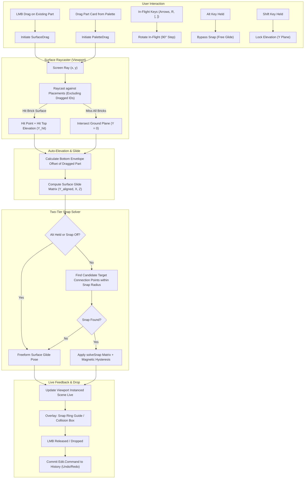
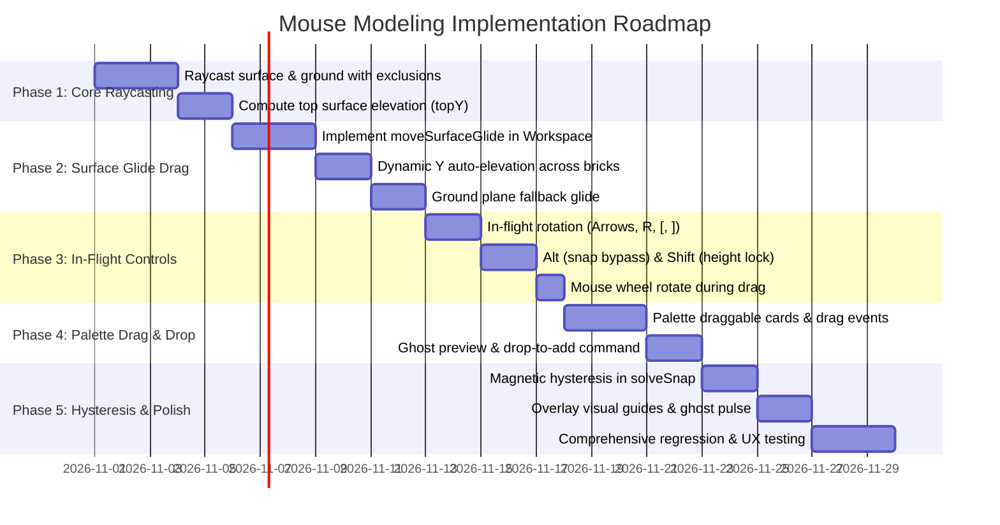

# Mouse Modeling & Interactive Part Placement Plan

**Palikkakehys Studio — Next-Generation 3D Assembly & Ergonomics**

---

## 1. Executive Summary & Goals

Palikkakehys Studio provides an in-browser LDraw modeling and gear-simulation environment built with Elm and WebGL. While it already features a Separating Axis Theorem (SAT) collision engine and mathematical connection-solving (`LDraw.Connectivity`), the **interactive mouse manipulation experience** currently lags behind industry-standard LEGO CAD tools such as **BrickLink Studio 2.0**, **LEGO Digital Designer (LDD)**, and **Mecabricks**.

Currently, dragging a brick by its body (`movePlaneDrag` in [Studio/Workspace.elm](file:///workspace/brick-frame/studio-app/src/Studio/Workspace.elm)) is locked to a single, 2D horizontal plane through the initial mouse-grab height ($Y$). It cannot climb onto underlying bricks, step down to lower tiers, or drop onto the baseplate. Furthermore, part placement from the palette requires a multi-step click-and-spawn workflow at the camera target rather than intuitive 3D drag-and-drop into the scene.

### Core Objectives
1. **Frictionless Palette Drag & Drop**: Enable dragging parts directly from the part palette into the 3D viewport, projecting a live 3D preview that tracks surfaces and snaps to existing geometry before release.
2. **Smooth 3D Surface Dragging ("Surface Glide")**: Replace the locked-plane drag with dynamic screen-to-surface raycasting. Dragged bricks must automatically calculate and adjust their elevation ($Y$) to rest neatly on top of whatever brick surface lies under the cursor.
3. **Smart Magnetic Connection Snapping**: Seamless stud-to-tube, stud-to-stud, and axle-to-hole snapping with hysteresis (stickiness) and immediate visual feedback (contact guides and collision highlights).
4. **In-Flight Rotation Mid-Drag**: Allow rotating the dragged part in 90° increments (or around the connection normal) using keyboard keys (`R`, Arrow keys, `[` / `]`) or mouse wheel without dropping or breaking the drag operation.
5. **Fluid Modifiers**: Support `Alt` to temporarily disable magnetic snapping for freeform surface gliding, and `Shift` to lock elevation or constrain movement planes.

---

## 2. Comparative Industry Research

### 2.1 BrickLink Studio (Studio 2.0)
* **Part Placement**:
  - Drag-and-drop from the left-hand palette into the 3D viewport. As the cursor crosses the palette boundary into the 3D canvas, a semi-transparent ghost of the part appears, bound to the cursor.
  - Hovering over existing model geometry aligns the part to the target face normal and auto-elevates the part so its bottom plane sits on the top surface of the hit brick.
  - Clicking a palette item without dragging arms it; clicking into the 3D space places it at the clicked surface.
* **Surface Dragging & Auto-Elevation**:
  - Grabbing an existing brick moves it across surfaces. Studio fires a ray from the camera through the mouse cursor into the scene (ignoring the dragged brick).
  - The brick's bottom surface aligns with the top surface of the intersected object. If no object is hit, it glides across the ground grid ($Y=0$).
* **Connection Snapping**:
  - Two-stage solver: (1) Surface glide sets general position/orientation, (2) Magnetic attraction engages when compatible connection points enter a search radius (approx. 10–16 LDU).
  - Studs snap to anti-stud tubes; Technic pins snap into pin holes.
  - Strict vs. Soft Collision: In Strict mode, snaps that cause bounding box intersections are rejected; in Soft mode, the snap is allowed but intersecting geometry is outlined in vibrant red.
* **Controls & Hotkeys**:
  - While dragging with Left Mouse Button (LMB), pressing **Arrow Keys** (Left/Right) or **R** rotates the part 90° about the connection normal (or vertical axis).
  - **Alt**: Bypasses connection snapping for fine continuous placement.
  - **Shift**: Locks the current vertical height ($Y$) so the brick does not jump up/down when passing over raised elements.

### 2.2 LEGO Digital Designer (LDD)
* **Surface Contact & "Brick Glide"**:
  - LDD pioneered intuitive virtual LEGO building. Bricks never feel like abstract 3D meshes floating in empty space; they behave like physical objects resting on solid surfaces.
  - As the mouse moves, the part glides across top surfaces. If the cursor moves over a 2-brick-high tower, the part steps up 48 LDU. If it moves off the edge, it steps down to the ground or the underlying brick.
* **Connection Snapping**:
  - Extremely responsive magnetic latching. Snapping has a distinct "gravity well" (hysteresis): the part stays latched to a connection until the cursor moves significantly away, preventing jitter.
  - Arrow keys cycle through allowable 90° orientations along the connected stud axis.
* **Palette Workflow**:
  - Single-click on a palette item attaches it to the cursor. The user moves into the 3D scene, positions it, and single-clicks to drop. The tool remains armed for stamping duplicates until cancelled (`Esc` or switching tools).

### 2.3 Mecabricks
* **Web-First CAD Interaction**:
  - Runs in the browser via Three.js / WebGL.
  - Uses Raycaster against instanced geometries.
  - Employs an LDU modular grid (20 LDU horizontal step, 8/24 LDU vertical step) overlaid with procedural snap-socket pairing.
  - Supports quick rotation hotkeys (`Q`, `W`, `E`, `R`, etc.) during placement to tumble parts in 90° steps along cardinal axes.

### Comparative Feature Matrix

| Feature | BrickLink Studio 2.0 | LEGO Digital Designer | Mecabricks | Palikkakehys Studio (Current) | Palikkakehys Studio (Target) |
| :--- | :--- | :--- | :--- | :--- | :--- |
| **Palette Placement** | Drag & drop + click-to-place | Click-to-arm & click-in-3D | Click to add / Drag & drop | Click to arm + "Add" button (spawns at camera target) | **Drag & drop onto surface + click-to-place** |
| **Body Dragging** | Dynamic surface raycast | Dynamic brick glide | Raycast onto meshes | Fixed 2D horizontal plane ($Y$ locked) | **Dynamic Surface Glide with auto-elevation** |
| **Elevation ($Y$) Adjustment** | Automatic based on hit object | Automatic step up/down | Automatic / Grid | None during drag (Y delta is 0) | **Automatic based on hit surface + baseplate fallback** |
| **Snap Solver** | Multi-type magnetic sockets | Geometry contact + sockets | Sockets & modular grid | `solveSnap` (Studs, axles, pins, clips) | **`solveSnap` + magnetic hysteresis + surface glide** |
| **In-Flight Rotation** | Arrow keys / R / Wheel | Arrow keys | Q/W/E/R keys | Arrow keys (only if already snapped) | **Arrow keys / R / Wheel (snapped & free-glide)** |
| **Modifier: Alt** | Bypasses snapping | Not supported | Bypasses grid | Bypasses snap (flat plane only) | **Bypasses snap (freeform surface glide)** |
| **Modifier: Shift** | Height lock / pan | Pan camera | Axis constrain | Pan camera | **Height/elevation lock or vertical lift** |
| **Collision Feedback** | Red highlight / drop rejection | Drop rejection | Visual overlap | Red outlines / Strict drop revert | **Live red collision outlines + snap guide** |

---

## 3. Deep Inspection of Palikkakehys Codebase

### 3.1 `packages/brick-frame-simulator/src/LDraw/Connectivity.elm`
* **Current Capabilities**:
  - Excellent foundation: cleanly defines `ConnectionType` (`Stud`, `AntiStud`, `TechnicPinMale/Female`, `TechnicAxleMale/Female`, `ClipMale`, `BarFemale`, `BallMale`, `BallSocketFemale`).
  - `solveSnap`: Takes `maxDist`, `rotationIndex`, `currentMatrix`, `draggedPoints`, `targetPoints`. Computes snap transform using orthonormal basis projection (`computeSnapMatrix`).
  - `checkCollisions`: Implements full 3D Separating Axis Theorem (SAT) testing between Oriented Bounding Boxes (`testOBB`), with `effectiveEnvelope` to discount 4 LDU stud protrusions.
  - Procedural & Catalog extraction: Extracts connection points from subfile references (`stud.dat`, `tube.dat`, etc.) and catalog brick definitions (`3001`, `3002`, `3003`, etc.).
* **Current Gaps**:
  - `solveSnap` relies entirely on Euclidean proximity: `Vec3.distance draggedWorldPos targetWorld.worldPosition < maxDist` (default 12 LDU). If the dragged part's $Y$ elevation is off because of fixed plane dragging, the distance between top studs and bottom tubes exceeds 12 LDU, and snapping never triggers.
  - Lacks surface contact calculation (e.g. finding the bottom-most extent of a part to rest it on top of a flat brick bounding box).
  - Lacks magnetic hysteresis (the snap threshold to latch is the same as the threshold to un-latch, causing jitter when moving along the edge of a snap radius).

### 3.2 `studio-app/src/Studio/Workspace.elm`
* **Current Drag Logic**:
  - `startDrag` checks gizmo handles, then calls `grabPart`:
    ```elm
    grabPart : ( Float, Float ) -> Model -> Maybe Drag
    grabPart ( x, y ) model =
        Viewport.pickPoint x y model.viewport
            |> Maybe.map (\hit -> { kind = PlaneDrag hit.point, ... })
    ```
  - `movePlaneDrag` defines the motion:
    ```elm
    movePlaneDrag : Drag -> Vec3.Vec3 -> ( Float, Float ) -> Model -> ( Model, Cmd Msg )
    movePlaneDrag drag grab ( x, y ) model =
        let
            planeHit =
                Pick.screenRay model.viewport.camera model.viewport.width model.viewport.height x y
                    |> Maybe.andThen (\( origin, direction ) ->
                        let
                            dy = Vec3.getY direction
                            t = (Vec3.getY grab - Vec3.getY origin) / dy
                        in
                        if abs dy < 0.05 || t <= 0 then Nothing
                        else Just (Vec3.add origin (Vec3.scale t direction))
                    )
        ...
        delta = vec3 (snapped (Vec3.getX moved)) 0 (snapped (Vec3.getZ moved))
    ```
    **Critical Flaw**: The plane is locked at $Y = \text{Vec3.getY grab}$. The delta has $Y = 0$. Parts cannot move vertically during a body drag.
  - In `applyDragDelta`, `solveSnap` is tested only against the horizontal translation.
  - In `Viewport.KeyAccepted`:
    ```elm
    if model.drag /= Nothing && model.activeSnap /= Nothing then
        -- Only allows rotation if activeSnap is Just!
    ```
    If the part is not snapped, arrow keys fall through to camera orbit or selection nudge, disrupting the drag.
  - `addPart`: Places parts strictly at `camera.target` on a fixed grid, rather than where the user clicks or drops.

### 3.3 `packages/brick-frame-viewport/src/Viewport.elm` & `Render/Pick.elm`
* **Current Picking Logic**:
  - `pickPoint : Float -> Float -> Model -> Maybe { source : Int, point : Vec3.Vec3 }` casts a screen ray and checks bounding sphere $\rightarrow$ local AABB $\rightarrow$ triangle mesh.
  - **Issues for Dragging**:
    1. During a drag, `pickPoint` tests *all* placements in `instancedScene.placements`. If the cursor is over the dragged brick, the ray hits the dragged brick itself at $t \approx 0$, blinding the raycaster from seeing the brick underneath!
    2. `pickPoint` does not return the hit surface normal $\vec{n}_{\text{hit}}$ or the hit placement's top bounding face height.

### 3.4 `studio-app/src/Studio/Palette.elm`
* Cards are currently static UI elements rendering thumbnails with click-to-arm and double-click handlers.
* No `draggable="true"`, `ondragstart`, or pointer drag streams to initiate 3D viewport drags.

---

## 4. Proposed Architecture & Interaction Design



### 4.1 Smooth 3D Surface Dragging ("Surface Glide")
Instead of fixing $Y$ to the initial grab point:
1. **Raycast with Exclusion**: Cast a ray through the screen coordinates $(x, y)$ using a new viewport function `pickSurfaceExcluding : Set Int -> Float -> Float -> Viewport.Model -> Maybe SurfaceHit`. This ignores the dragged brick(s) so the ray hits the underlying model geometry or ground.
2. **Ground Plane Fallback**: If no brick is hit, intersect the ray with the horizontal ground plane ($Y = 0$ in document space, or baseplate level).
3. **Bounding Envelope Alignment**:
   - Every LEGO part has a local bounding box $[min, max]$. In LDraw coordinates, $Y$ points down, so the bottom surface of a standard brick is at $Y = max.y$ (or $Y = 24$ for standard 24 LDU bricks, $Y = 8$ for plates).
   - When a ray hits a surface at world height $Y_{\text{surface}}$, the dragged part's origin is elevated such that its bottom aligns with $Y_{\text{surface}}$:
     $$Y_{\text{part}} = Y_{\text{surface}} - \text{bottomExtent}$$
   - This allows parts to instantly "climb" onto walls, step onto roofs, or drop into courtyards simply by sliding the mouse over them.
4. **Elevation Smoothing / Step-Up**:
   - Provide a natural threshold so micro-ridges (like stud tops) don't cause jitter when sliding across a flat top face.

### 4.2 Two-Tier Snapping Pipeline with Hysteresis
1. **Tier 1 — Surface Glide Pose**:
   - Positions the part at $(X_{\text{hit}}, Y_{\text{aligned}}, Z_{\text{hit}})$, with orientation matching the active rotation step (snapped to the cardinal 90° orientation closest to its original angle, or user-rotated).
2. **Tier 2 — Magnetic Connection Snapping**:
   - From this Surface Glide pose, connection points on the dragged brick are now at approximately the exact height of the target studs/tubes!
   - Evaluate `Connectivity.solveSnap` against target connection points within `snapDistance` (12.0 LDU).
   - **Hysteresis (Magnetic Latch)**:
     - Entry threshold: $D_{\text{enter}} = 12.0\text{ LDU}$ to snap in.
     - Exit threshold: $D_{\text{exit}} = 18.0\text{ LDU}$ to release.
     - When snapped, keep the snapped pose until the cursor moves further than $D_{\text{exit}}$ away from the snap point. This eliminates the irritating jitter experienced when hovering near snap borders.
3. **Collision Checking**:
   - When snapped or gliding, execute `Connectivity.checkCollisions 0.5`.
   - In `CollisionStrict` mode: Snaps that cause physical collisions are suppressed or highlighted. If released while colliding, it reverts to the original pre-drag state or last valid non-colliding pose.
   - In `CollisionSoft` mode: The snap is allowed, and intersecting parts are highlighted with red bounding wireframes in `Studio.Overlay`.

### 4.3 In-Flight Mid-Drag Rotation
A cornerstone of fluid CAD interaction is rotating a part *while holding it*:
* **Keys Supported**: `ArrowLeft` / `ArrowRight`, `R`, `[` / `]`, or Mouse Wheel.
* **Dual Behavior**:
  1. **When Snapped**:
     - Rotating modifies `snapRotationStep` ($\pm 1$).
     - The part turns in 90° increments around the **connection normal axis** ($\vec{n}_{\text{target}}$).
     - Example: If snapped on top of a stud ($\vec{n} = [0, -1, 0]$), it spins in yaw. If snapped to a horizontal Technic pin ($\vec{n} = [0, 0, 1]$), it spins in roll/pitch.
  2. **When Surface Gliding (Unsnapped)**:
     - Rotating modifies `inFlightRotationStep` ($\pm 1$).
     - The part turns in 90° increments around the vertical axis ($Y$).
* **Wheel-to-Rotate**:
  - Optional setting: Scrolling the mouse wheel while holding a part rotates it in 90° steps without needing a hand on the keyboard.

### 4.4 Modifiers: Alt and Shift
* **`Alt` (Snap Bypass)**:
  - Holding `Alt` sets `snapDistance = 0` for the duration of the keypress.
  - The brick slides smoothly across surfaces according to the move grid step (e.g. 1 LDU or 4 LDU) without being captured by magnetic studs.
* **`Shift` (Elevation Lock / Vertical Nudge)**:
  - Holding `Shift` while dragging freezes the current $Y$ elevation plane.
  - This allows the user to slide a brick across an open chasm or extend a cantilever into empty space without the part dropping down to the ground plane.

### 4.5 Drag & Drop from Part Palette
* **Workflow**:
  1. User presses mouse down on a part card in `Studio.Palette` and moves into the canvas (HTML5 drag or pointer tracking).
  2. Workspace receives `PaletteDragStarted part (x, y)`.
  3. A temporary virtual placement is added to the scene (or preview state).
  4. Viewport processes `PaletteDragMoved (x, y)` through the exact same Surface Glide and Snap solver pipeline as existing part dragging!
  5. The part appears under the cursor, climbs surfaces, snaps to studs, and responds to `R`/Arrow keys.
  6. Releasing mouse over the canvas triggers `PaletteDragEnded`: commits `Edit.Command.Add` with the final matrix to history.
  7. Pressing `Escape` or dragging back to the palette cancels placement.

---

## 5. Detailed Implementation Blueprint

### Phase 1: Viewport & Surface Picking Enhancements

#### File: `packages/brick-frame-simulator/src/Render/Pick.elm`
* Add `rayPlaneHit : Vec3 -> Vec3 -> Vec3 -> Vec3 -> Maybe (Float, Vec3)`:
  - Intersects ray `(origin, direction)` with an arbitrary plane defined by a point on the plane and a plane normal.
* Add ground plane intersection:
  - Intersect ray with horizontal ground plane $Y = 0$.

#### File: `packages/brick-frame-viewport/src/Viewport.elm`
* Expose `pickSurfaceExcluding : Set Int -> Float -> Float -> Model -> Maybe { source : Int, point : Vec3, normal : Vec3, topY : Float }`:
  - Filters out placements where `Set.member p.source excludedIds`.
  - Computes the intersection with scene geometry.
  - Determines the hit normal and calculates the top bounding elevation (`topY`) of the hit placement in LDraw coordinates.
* Add `groundIntersection : Float -> Float -> Model -> Maybe Vec3`:
  - Returns the world-space intersection of the cursor ray with the ground plane $Y = 0$.

### Phase 2: Surface Glide & Auto-Elevation in Workspace

#### File: `studio-app/src/Studio/Workspace.elm`
* Replace `movePlaneDrag` with `moveSurfaceGlide`:
  ```elm
  type DragKind
      = LinearDrag Gizmo.Handle
      | ArcDrag Gizmo.ArcHandle
      | SurfaceDrag { grabOffset : Vec3, initialPartY : Float }
      | PaletteDrag { part : Part, inFlightRotation : Int }
  ```
* Compute surface alignment in `moveSurfaceGlide`:
  1. Call `Viewport.pickSurfaceExcluding dragIds x y model.viewport`.
  2. If hit:
     - Target $Y = \text{hit.topY} - \text{leadPartBottomOffset}$.
     - Target $X = \text{hit.point.x}$, Target $Z = \text{hit.point.z}$.
  3. If no hit:
     - Call `Viewport.groundIntersection x y model.viewport`.
     - Target $Y = 0 - \text{leadPartBottomOffset}$.
  4. Feed target matrix into `Connectivity.solveSnap`.
  5. If snap candidate found $\rightarrow$ set `activeSnap = Just candidate`.
  6. If no snap candidate $\rightarrow$ set `activeSnap = Nothing`, use surface glide matrix.

### Phase 3: In-Flight Rotation & Modifier Integration

#### File: `studio-app/src/Studio/Workspace.elm`
* Update `Viewport.KeyAccepted`:
  - When `model.drag /= Nothing`:
    - If `key == "ArrowLeft" || key == "ArrowDown" || key == "["`:
      - If `model.activeSnap /= Nothing`: decrement `snapRotationStep`.
      - Else: decrement `inFlightRotationStep`.
      - Re-evaluate drag at `drag.lastPoint`.
    - If `key == "ArrowRight" || key == "ArrowUp" || key == "r" || key == "R" || key == "]"`:
      - If `model.activeSnap /= Nothing`: increment `snapRotationStep`.
      - Else: increment `inFlightRotationStep`.
      - Re-evaluate drag at `drag.lastPoint`.
    - If `key == "Alt"`:
      - Toggle snap bypass; re-evaluate drag.
    - If `key == "Shift"`:
      - Toggle elevation lock; re-evaluate drag.
* Add Wheel event handling during drag:
  - Scrolling up/down while dragging a part rotates it by 90°.

### Phase 4: Palette Drag-and-Drop Workflow

#### File: `studio-app/src/Studio/Palette.elm`
* Update part cards in `viewCard`:
  - Add attributes: `Attr.attribute "draggable" "true"`, `Html.Events.on "dragstart" ...`, `Html.Events.on "dragend" ...`.
  - Alternatively, bind `onMouseDown` to initiate a pointer-drag session that tracks into the canvas.

#### File: `studio-app/src/Studio/Workspace.elm`
* Add messages:
  - `PaletteDragStarted Part (Float, Float)`
  - `PaletteDragMoved (Float, Float)`
  - `PaletteDragEnded`
  - `PaletteDragCancelled`
* On start:
  - Instantiates ghost part, sets `drag = Just (PaletteDrag ...)`.
* On move:
  - Runs through `moveSurfaceGlide`.
* On end:
  - Commits `Edit.Command.Add` to the document.

### Phase 5: Magnetic Hysteresis & Visual Polish

#### File: `packages/brick-frame-simulator/src/LDraw/Connectivity.elm`
* Update `solveSnapWithHysteresis`:
  - If a snap candidate is already active (`currentSnap : Maybe SnapCandidate`), use a widened search threshold (e.g. `snapDistance * 1.5`) for the current connection pair.
  - Only break the latch if mouse translation pulls it past the hysteresis envelope.

#### File: `studio-app/src/Studio/Overlay.elm`
* Enhance `SnapGuide` rendering:
  - Render an ethereal ghost/halo of the target stud ring.
  - When in collision, tint ghost in transparent crimson.
  - When valid snap, display an emerald/cyan snap pulse.

---

## 6. Phased Implementation Roadmap



### Milestone Deliverables

| Milestone | Deliverables | Verification Criteria |
| :--- | :--- | :--- |
| **M1: Surface Glide** | `pickSurfaceExcluding`, `moveSurfaceGlide`, auto-elevation | Dragging a 2x4 brick over a 3-brick-high wall lifts it to $Y=-72$ automatically; sliding off lands it on $Y=0$. |
| **M2: In-Flight Controls** | Arrow/R rotation mid-drag, Alt bypass, Shift height lock | Pressing `R` while dragging spins the brick 90° without dropping. Holding `Alt` slides smoothly without magnetic snap. |
| **M3: Palette Drag & Drop** | Palette card drag into canvas, live ghost, drop commit | Dragging a part from the palette into the canvas drops it directly on top of model bricks with full undo history. |
| **M4: Hysteresis & Polish** | Snap hysteresis ($12 \rightarrow 18$ LDU), snap guides, SAT feedback | No snap flickering on borders; clear snap cues; invalid strict drops revert cleanly. |

---

## 7. Edge Cases & Performance Considerations

1. **Grazing Screen Rays (Horizon Dragging)**:
   - When the camera is viewed almost horizontally ($\theta_{\text{elevation}} \approx 0$), screen rays towards the horizon can produce extreme distances $t \rightarrow \infty$.
   - **Remedy**: Clamp ground and surface intersections to a maximum radius from the camera or bounding sphere of the model ($2 \times sceneRadius$).
2. **High-Poly Models & SAT Collision Performance**:
   - Testing SAT collision on every pointer move event can cause frame drops on large models (1000+ parts).
   - **Remedy**: Use the existing bounding sphere broad-phase pruning before calling `Connectivity.checkCollisions`. Only run full OBB SAT tests on candidates whose bounding spheres overlap.
3. **Multi-Part Selection Dragging**:
   - When dragging multiple parts (e.g., an entire sub-assembly), designate the clicked part as the **lead part**.
   - Calculate surface glide and snapping for the lead part, and apply the exact rigid transformation delta ($\Delta M$) to all other selected parts.
4. **Submodel Coordinate Transformations**:
   - When editing inside a nested submodel (`model.context.path /= []`), all world-space raycast hits must be converted to local submodel space via `Mat4.inverse accumulatedTransform`.
5. **Touch & Mobile Support**:
   - On touch devices, single-finger drag should invoke surface glide, with on-screen rotation buttons or a secondary touch tap to trigger 90° rotation while holding.
