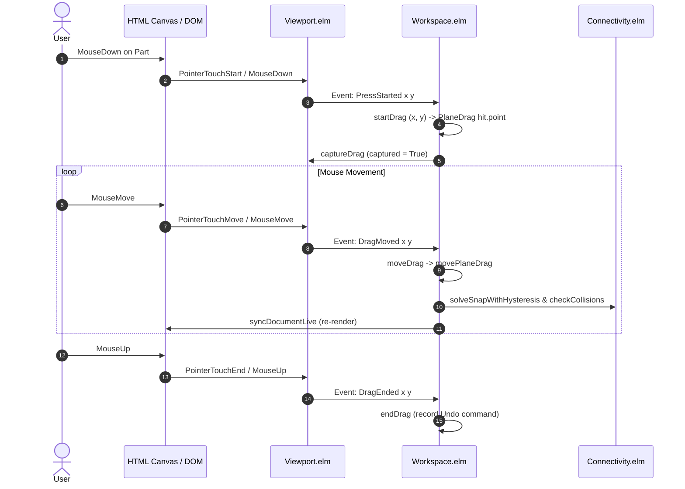

# Three-Axis Mouse Movement & Elevation Control Design

**Palikkakehys Studio — Fluid 3D CAD Manipulation Without Releasing Drag**

---

## 1. Executive Summary & Problem Statement

In 3D CAD and virtual brick construction, positioning parts accurately in all three dimensions ($X, Y, Z$) using a 2D mouse is a fundamental ergonomic challenge. 

In Palikkakehys Studio:
- **Direct Part Dragging (`PlaneDrag`)** is largely locked to a horizontal $(X, Z)$ surface plane. Vertical ($Y$) elevation is passive—it only changes if the ray under the cursor hits an existing brick's top surface.
- When dragging into open space, the part plunges down to the baseplate grid ($Y = 0$).
- While holding `Shift` currently freezes elevation to the original part height (`origPos.y`), the user **cannot actively elevate or lower the part** during a mouse drag.
- To change elevation manually, the user must release the part, switch to or click the vertical Gizmo handle ($Y$), drag it, and release again.
- Rolling the mouse wheel during a drag triggers camera zoom (`Navigation.applyWheel`), moving the entire viewpoint instead of adjusting the brick's position.

### Design Objective
Design an intuitive, multi-modal interaction system that allows users to seamlessly translate parts along all three axes ($X, Y, Z$) **without ever releasing the mouse button**.

The proposed solution unites three complementary interaction modalities:
1. **Vertical ($Y$) Modifier Drag (Continuous)**: Holding a modifier key (e.g., `Shift`) mid-drag switches mouse motion to vertical lift along world/local $Y$, resuming horizontal motion upon release without jumping.
2. **Mouse Wheel Elevation (Discrete Modular Steps)**: Rolling the mouse wheel while dragging steps vertical elevation in LEGO-modular increments (8 LDU per plate, 24 LDU per brick, 1 LDU fine).
3. **Axis Lock Keys (`X`, `Y`, `Z`) (Blender-Style Constraints)**: Pressing `X`, `Y`, or `Z` while dragging locks movement strictly to that axis; pressing again toggles back to unconstrained plane motion.

---

## 2. Deep Inspection of Current Implementation

### 2.1 Drag Event Flow & Lifecycle



### 2.2 Current State Representation ([`Studio.Workspace`](file:///workspace/brick-frame/studio-app/src/Studio/Workspace.elm#L193-L200))

```elm
type alias Drag =
    { kind : DragHandle
    , ids : List Int
    , start : ( Float, Float )
    , lastPoint : ( Float, Float )
    , original : Document
    , amount : Float
    }
```

Where [`DragHandle`](file:///workspace/brick-frame/studio-app/src/Studio/Gizmo.elm#L66-L70) is defined in [`Studio.Gizmo`](file:///workspace/brick-frame/studio-app/src/Studio/Gizmo.elm):
```elm
type DragHandle
    = LinearDrag Handle
    | ArcDrag ArcHandle
    | PlaneDrag Vec3
```

- `PlaneDrag Vec3`: Holds `grab`, the initial 3D hit point in render coordinates on the part surface.
- `start`: Initial canvas pixel coordinates $(x, y)$.
- `lastPoint`: Most recent canvas pixel coordinates $(x, y)$.
- `original`: Snapshot of the `LDraw.Document` before the drag began. All drag operations compute displacements relative to `original` to prevent numerical drift.
- `amount`: Scalar float tracking linear or angular displacement (unused during `PlaneDrag`).

### 2.3 Current Plane Drag Logic ([`movePlaneDrag`](file:///workspace/brick-frame/studio-app/src/Studio/Workspace.elm#L3015-L3095))

In `movePlaneDrag drag grab ( x, y ) model`:
```elm
surfaceHit = Viewport.pickSurfaceExcluding draggedIds x y model.viewport
...
targetY =
    if model.shiftHeld then
        Vec3.getY origPos
    else
        hit.topY - bottomExtent

docHit = Gizmo.toRender hit.point
targetX = toFloat (round (Vec3.getX docHit / step)) * step
targetZ = toFloat (round (Vec3.getZ docHit / step)) * step
```

#### Identified Limitations:
1. **Passive Elevation**: $Y$ position is determined solely by `hit.topY - bottomExtent`. The user has zero direct control over height during part drag.
2. **Shift Key Under-Utilization**: `shiftHeld` is only a binary freeze flag (`targetY = origPos.y`). It does not allow raising or lowering.
3. **Viewport Wheel Interception**: `Viewport.elm` line 700 intercepts all wheel events and modifies `camera.distance` or dollies walk navigation, even when `model.captured == True`.
4. **Lack of Mid-Drag Mode Transitions**: Drag state has no memory of sub-gestures or mode switches. If an axis constraint is activated mid-drag, calculating delta from `drag.start` produces a violent spatial jump.

---

## 3. Coordinate Systems & Mathematical Projection

Brick Frame operates across three distinct coordinate systems:

| Coordinate System | Handedness & Orientation | Usage |
| :--- | :--- | :--- |
| **LDraw Document Space** | Right-handed, **$Y$-Down**, $+X$ Right, $+Z$ Forward | Placements, part geometry, `.ldr`/`.mpd` file output |
| **Render Space (WebGL)** | Right-handed, **$Y$-Up**, $+X$ Right, $+Z$ Forward | Camera view/projection matrices, GPU vertex buffers |
| **Canvas Screen Space** | 2D, $+x$ Right, **$+y$ Down** (pixels from top-left) | Pointer events, UI overlays, gizmo hit testing |

```
    LDraw Space (Y-Down)              Render Space (Y-Up)              Screen Space (Pixels)
           -Y (Up)                           +Y (Up)                          (0,0) ------> +x
              |                                 |                               |
              |                                 |                               |
    -X -------+------- +X             -X -------+------- +X                     v
             / \                               / \                             +y
            /   \                             /   \
      -Z (Back)  +Z (Front)             -Z (Back)  +Z (Front)
```

### 3.1 Mapping 2D Screen Drag to 3D Vertical Axis ($Y$)

To map mouse motion naturally to the 3D vertical axis from **any camera orientation**:
1. Take the current 3D world origin of the dragged selection: $\mathbf{P}_0 = (X_0, Y_0, Z_0)$.
2. Define a reference point along the vertical axis in Render Space ($Y$-up):
   $$\mathbf{P}_{up} = \mathbf{P}_0 + L \cdot \begin{pmatrix} 0 \\ 1 \\ 0 \end{pmatrix}$$
   where $L = 100 \text{ LDU}$.
3. Project both points to 2D screen coordinates using `Gizmo.project`:
   $$\mathbf{s}_0 = \text{project}(\mathbf{P}_0) = (s_{0x}, s_{0y})$$
   $$\mathbf{s}_{up} = \text{project}(\mathbf{P}_{up}) = (s_{upx}, s_{upy})$$
4. Compute the 2D projected screen vector:
   $$\mathbf{d} = \mathbf{s}_{up} - \mathbf{s}_0 = (d_x, d_y), \quad \|\mathbf{d}\|^2 = d_x^2 + d_y^2$$
5. For a mouse movement from anchor $\mathbf{m}_0$ to current pointer $\mathbf{m} = (x, y)$, the displacement is $\Delta \mathbf{m} = \mathbf{m} - \mathbf{m}_0$.
6. The scalar distance along the 3D axis is calculated using the dot product:
   $$t = \frac{\Delta \mathbf{m} \cdot \mathbf{d}}{\|\mathbf{d}\|^2} \cdot L$$
7. **LDraw Conversion**: Because LDraw uses $Y$-down, the change in LDraw units is:
   $$\Delta Y_{LDraw} = -t$$
   *(Moving mouse up on screen results in $d_y < 0$ and $\Delta m_y < 0$, yielding $t > 0$ and $\Delta Y_{LDraw} < 0$, which correctly moves the part UP in LDraw space).*
8. **Zenith / Top-Down Degeneracy Fallback**:
   If $\|\mathbf{d}\|^2 < 1.0$ (camera is looking directly down along the Y-axis), screen projection collapses to a point. In this edge case, fall back to direct vertical pixel mapping:
   $$\Delta Y_{LDraw} = -(y - y_0) \cdot 1.0$$

---

## 4. The Three Interaction Modalities

```
                        ┌────────────────────────────────────────────────────────┐
                        │             Active Drag Session (LMB Held)             │
                        └──────────────────────────┬─────────────────────────────┘
                                                   │
         ┌─────────────────────────────────────────┼─────────────────────────────────────────┐
         ▼                                         ▼                                         ▼
┌──────────────────────────────┐        ┌──────────────────────────────┐        ┌──────────────────────────────┐
│  Modality 1: Vertical Hold   │        │   Modality 2: Mouse Wheel    │        │   Modality 3: Axis Locks     │
│  (Shift or Y Key Held)       │        │   (Wheel Scroll During Drag) │        │   (X, Y, Z Keys Toggled)     │
├──────────────────────────────┤        ├──────────────────────────────┤        ├──────────────────────────────┤
│ • Continuous 1:1 elevation   │        │ • Discrete modular stepping  │        │ • Strict 1D axis constraint  │
│ • Freezes X/Z translation    │        │ • Default: 8 LDU (1 plate)   │        │ • Works in World/Local frame │
│ • Screen vector dot product  │        │ • Shift+Wheel: 24 LDU (brick)│        │ • Tap same key to unlock     │
│ • Seamless return to plane   │        │ • Alt+Wheel: 1 LDU (fine)    │        │ • Visual RGB guide line      │
└──────────────────────────────┘        └──────────────────────────────┘        └──────────────────────────────┘
```

---

### 4.1 Modality 1: Vertical ($Y$) Translation Modifier (Continuous)

#### Interaction Workflow:
1. User clicks and starts dragging a part across surfaces on the horizontal $(X, Z)$ plane.
2. Without releasing LMB, user presses and holds **`Shift`** (or holds **`Y`**).
3. The current horizontal position is pinned. Mouse movement now translates the part purely along the vertical axis ($Y$).
4. User releases `Shift` (or `Y`).
5. The part remains at its newly attained elevation; mouse movement smoothly resumes gliding horizontally across the $(X, Z)$ plane at this new height.

#### Seamless Mode-Switching (Zero-Jump Architecture):
To avoid sudden teleportation when pressing/releasing modifiers mid-drag:
- `Drag` stores `elevationOffset : Float`.
- When switching into Vertical Mode:
  - Record `modeAnchorScreen = (x, y)`.
  - Record `baseElevation = elevationOffset`.
- While moving in Vertical Mode:
  - $\Delta Y = \text{projectedDelta}(\text{modeAnchorScreen}, (x, y))$.
  - $\text{elevationOffset} = \text{baseElevation} + \Delta Y$.
- When switching out of Vertical Mode:
  - `elevationOffset` retains the final height.
  - Reset plane raycasting reference point to current cursor $(x, y)$.

---

### 4.2 Modality 2: Mouse Wheel Elevation (Discrete Modular Steps)

The mouse wheel is the most ergonomic device for incremental 3D stepping because it does not require holding down additional keys or diverting pointer trajectory.

#### Interaction Workflow:
1. User grabs a brick and hovers over an assembly.
2. User scrolls the mouse wheel **Up (Forward)**:
   - Elevation increases by **8 LDU** (1 LEGO plate height).
   - In LDraw coordinates: $Y_{offset} \leftarrow Y_{offset} - 8.0$.
3. User scrolls the mouse wheel **Down (Backward)**:
   - Elevation decreases by **8 LDU**.
   - In LDraw coordinates: $Y_{offset} \leftarrow Y_{offset} + 8.0$.
4. **Modifier Combinations with Wheel**:
   - **Plain Wheel**: Step by **8 LDU** (1 plate).
   - **`Shift` + Wheel**: Step by **24 LDU** (1 full brick = 3 plates).
   - **`Alt` + Wheel**: Step by **1 LDU** (fine precision).

#### Viewport Interception:
In `packages/brick-frame-viewport/src/Viewport.elm`:
```elm
Wheel delta ->
    if model.captured then
        -- Host has captured the drag: pass wheel delta to host instead of zooming camera
        ( model, Cmd.none, [ WheelScrolled delta ] )
    else
        ( { model
            | camera = Navigation.applyWheel delta model.camera
            , cameraMode = CameraManual
          }
        , Cmd.none
        , [ CameraSettled ]
        )
```

---

### 4.3 Modality 3: Axis Lock Keys (`X`, `Y`, `Z`) (Blender-Style Constraints)

For precise structural alignment over long distances, freeform 2D plane motion can cause accidental drift. Single-axis locking provides absolute precision.

#### Interaction Workflow:
1. While dragging with LMB, the user taps **`X`**, **`Y`**, or **`Z`**.
2. Motion instantly constrains to that axis in 3D space:
   - **`X`**: Part moves only along the $X$ axis.
   - **`Y`**: Part moves only along the $Y$ axis (vertical).
   - **`Z`**: Part moves only along the $Z$ axis.
3. Tapping the **same axis key again** (or pressing `Esc`) toggles the constraint off, returning to free horizontal plane glide.
4. Tapping a **different axis key** (e.g., `Z` while locked to `X`) immediately switches constraint to the new axis.

#### Coordinate Frame Support (World vs. Local):
- In `WorldFrame`: Axis aligns with world cardinal axes (`vec3 1 0 0`, `vec3 0 1 0`, `vec3 0 0 1`).
- In `LocalFrame`: Axis aligns with parent submodel/placement orientation via `Gizmo.transformDirection frameTransform (Edit.axisVector axis)`.

---

## 5. Snapping, Hysteresis, and Collision Integration

A critical requirement of 3-axis manipulation is that **magnetic stud snapping and collision detection must remain fully active and responsive during elevation and constrained motion**.

### 5.1 Snapping with Elevation Offset

In `Studio.Workspace.movePlaneDrag`:
1. Calculate candidate base position $\mathbf{P}_{base} = (X_{hit}, Y_{hit}, Z_{hit})$.
2. Apply active constraints and elevation offset:
   $$\mathbf{P}_{candidate} = \begin{pmatrix} X_{constrained} \\ Y_{hit} + \text{elevationOffset} \\ Z_{constrained} \end{pmatrix}$$
3. Construct `leadSurfaceMatrix` at $\mathbf{P}_{candidate}$ with `inFlightRotationStep`.
4. Run `Connectivity.solveSnapWithHysteresis`:
   ```elm
   maybeSnap =
       Connectivity.solveSnapWithHysteresis
           model.snapDistance
           (model.snapDistance * 1.5)
           model.activeSnap
           model.snapRotationStep
           leadSurfaceMatrix
           leadConn.connections
           targetWorldPoints
   ```
5. **Plate Stepping Synergy**:
   Because 1 wheel notch = 8 LDU and 1 brick = 24 LDU, stepping vertically lands the part's anti-studs directly into the capture basin of underlying studs (capture radius = 12 LDU). Snapping engages with tactile precision!

### 5.2 Collision Feedback

If an elevation or movement causes bounding box penetration:
- Separating Axis Theorem (SAT) in `Connectivity.checkCollisions` detects intersecting placements.
- In `Strict` mode: snap is rejected if collision occurs.
- In `Soft` mode: placement snaps, but colliding parts are rendered with vibrant red bounding outlines.

---

## 6. Visual Affordances & HUD Feedback

To make 3-axis movement intuitive, users need clear visual feedback indicating which axis is locked and how much elevation has been applied.

```
+-------------------------------------------------------------------------+
| [3D Viewport]                                                           |
|                                                                         |
|                 | Y-Axis (Green)                                        |
|                 |                                                       |
|                 o [Brick Preview]                                       |
|                / \                                                      |
|               /   \                                                     |
|   X-Axis (Red)     Z-Axis (Blue)                                        |
|                                                                         |
|                                                                         |
| [HUD Badge]:  Elevation: +24 LDU (3 plates)  |  [Y-Axis Locked]         |
+-------------------------------------------------------------------------+
```

1. **Active Axis Ray**:
   When an axis lock is active ($X, Y,$ or $Z$), an infinite or extended colored guide ray is drawn through the part center:
   - **$X$-Axis**: Red (`#EF4444`)
   - **$Y$-Axis**: Green (`#10B981`)
   - **$Z$-Axis**: Blue (`#3B82F6`)
2. **HUD Elevation Badge**:
   While `elevationOffset /= 0` or while dragging vertically, a semi-transparent HUD pill appears near the cursor or bottom-center:
   `"Elevation: +24 LDU (1 brick)"` or `"Elevation: -8 LDU (-1 plate)"`.
3. **Cursor Styling**:
   - Free Plane: `cursor: grabbing`
   - Vertical ($Y$): `cursor: ns-resize`
   - Horizontal ($X$ or $Z$): `cursor: ew-resize` or directional arrows.

---

## 7. Concrete Elm Implementation Plan

### 7.1 Enhancements to [`packages/brick-frame-viewport`](file:///workspace/brick-frame/packages/brick-frame-viewport/)

#### [`src/Viewport.elm`](file:///workspace/brick-frame/packages/brick-frame-viewport/src/Viewport.elm)
Add `WheelScrolled Float` to `Event`:
```elm
type Event
    = CameraSettled
    | Clicked Float Float Bool
    | DoubleClicked Float Float
    | Tapped Float Float
    | PressStarted Float Float
    | DragMoved Float Float
    | DragEnded Float Float
    | WheelScrolled Float          -- NEW: Wheel event when drag is captured
    | LoadStarted
    ...
```

Update `update` handler for `Wheel`:
```elm
Wheel delta ->
    if model.captured then
        ( model, Cmd.none, [ WheelScrolled delta ] )

    else
        ( { model
            | camera = Navigation.applyWheel delta model.camera
            , cameraMode = CameraManual
          }
        , Cmd.none
        , [ CameraSettled ]
        )
```

---

### 7.2 Enhancements to [`studio-app/src/Studio/Workspace.elm`](file:///workspace/brick-frame/studio-app/src/Studio/Workspace.elm)

#### Extend `Drag` Record
```elm
type AxisConstraint
    = ConstraintX
    | ConstraintY
    | ConstraintZ

type alias Drag =
    { kind : DragHandle
    , ids : List Int
    , start : ( Float, Float )
    , lastPoint : ( Float, Float )
    , original : Document
    , amount : Float
    -- NEW 3-Axis Fields:
    , elevationOffset : Float
    , axisConstraint : Maybe AxisConstraint
    , modeAnchor : ( Float, Float )
    , baseElevation : Float
    }
```

#### Handle `Viewport.WheelScrolled`
In `Workspace.update` under `ViewportMsg`:
```elm
Viewport.WheelScrolled delta ->
    case model.drag of
        Just drag ->
            let
                stepSize =
                    if model.shiftHeld then
                        24.0   -- 1 brick

                    else if model.altHeld then
                        1.0    -- fine

                    else
                        8.0    -- 1 plate

                direction =
                    if delta < 0 then
                        -1.0   -- Wheel up = Elevate UP (LDraw -Y)

                    else
                        1.0    -- Wheel down = Lower DOWN (LDraw +Y)

                newOffset =
                    drag.elevationOffset + (direction * stepSize)

                updatedDrag =
                    { drag | elevationOffset = newOffset }

                ( nextModel, cmd ) =
                    moveDrag updatedDrag drag.lastPoint { model | drag = Just updatedDrag }
            in
            ( nextModel, cmds ++ [ cmd ] )

        Nothing ->
            ( model, cmds )
```

#### Handle Key Presses Mid-Drag (`KeyAccepted` & `KeyUp`)
In `Viewport.KeyAccepted keyEvent`:
```elm
case model.drag of
    Just d ->
        let
            key =
                String.toLower keyEvent.key
        in
        if key == "x" then
            let
                nextConstraint =
                    if d.axisConstraint == Just ConstraintX then Nothing else Just ConstraintX
                updatedDrag =
                    { d | axisConstraint = nextConstraint, modeAnchor = d.lastPoint }
            in
            moveDrag updatedDrag d.lastPoint { model | drag = Just updatedDrag }

        else if key == "y" then
            let
                nextConstraint =
                    if d.axisConstraint == Just ConstraintY then Nothing else Just ConstraintY
                updatedDrag =
                    { d | axisConstraint = nextConstraint, modeAnchor = d.lastPoint }
            in
            moveDrag updatedDrag d.lastPoint { model | drag = Just updatedDrag }

        else if key == "z" then
            let
                nextConstraint =
                    if d.axisConstraint == Just ConstraintZ then Nothing else Just ConstraintZ
                updatedDrag =
                    { d | axisConstraint = nextConstraint, modeAnchor = d.lastPoint }
            in
            moveDrag updatedDrag d.lastPoint { model | drag = Just updatedDrag }

        else if keyEvent.key == "Shift" then
            -- Transition into Vertical Shift Drag without jumping
            let
                updatedDrag =
                    { d | modeAnchor = d.lastPoint, baseElevation = d.elevationOffset }
            in
            moveDrag updatedDrag d.lastPoint { withMods | drag = Just updatedDrag }

        else
            ...
```

In `KeyUp key`:
```elm
KeyUp key ->
    if key == "Shift" then
        let
            nextModel =
                { model | shiftHeld = False }
        in
        case nextModel.drag of
            Just d ->
                -- Lock current elevation into elevationOffset and resume horizontal plane glide
                let
                    updatedDrag =
                        { d | modeAnchor = d.lastPoint, baseElevation = d.elevationOffset }
                in
                moveDrag updatedDrag d.lastPoint { nextModel | drag = Just updatedDrag }

            Nothing ->
                ( nextModel, Cmd.none )
```

---

## 8. Verification & Test Plan

| Test Area | Scenario | Expected Outcome |
| :--- | :--- | :--- |
| **Wheel Elevation** | Scroll wheel up 3 notches while dragging brick | Brick elevates by 24 LDU (3 plates); snaps to stud tier above; no camera zoom |
| **Shift+Wheel** | Hold Shift and scroll wheel up 1 notch | Brick elevates by 24 LDU (1 brick height) |
| **Modifier Drag** | Hold Shift mid-drag and move mouse vertically | Brick moves strictly along vertical $Y$ axis; releasing Shift resumes horizontal glide at new height |
| **Zero-Jump Check** | Drag horizontally 200px, press Shift, move 50px | No spatial jump when Shift is pressed; vertical delta begins from current position |
| **Axis Lock Toggle** | Press `X` mid-drag, move mouse diagonally | Motion is strictly constrained to $X$ axis; pressing `X` again restores plane movement |
| **Top-Down Edge Case** | Set camera to Top view, hold Shift and drag | Fallback vertical mapping engages smoothly without division by zero or NaN |
| **Undo / Redo** | Complete a 3-axis drag with wheel + plane moves and release LMB | Exactly 1 undo command recorded in history containing final 3D matrix |

---

## 9. Conclusion

By combining continuous **Vertical Modifier Dragging**, discrete **Mouse Wheel Stepping**, and **Blender-Style Axis Locks**, Palikkakehys Studio elevates browser-based CAD manipulation to professional standards. Users gain complete, unconstrained 3D freedom without releasing the mouse or switching tools.
